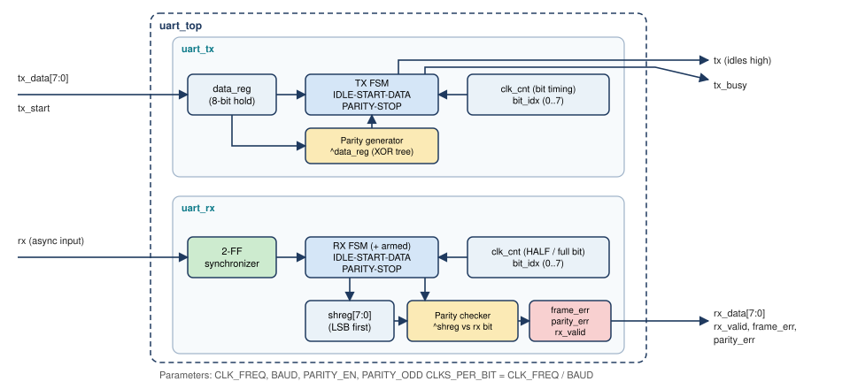
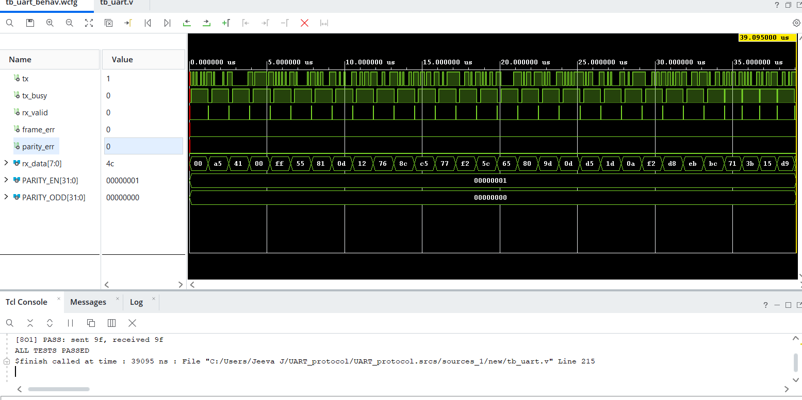
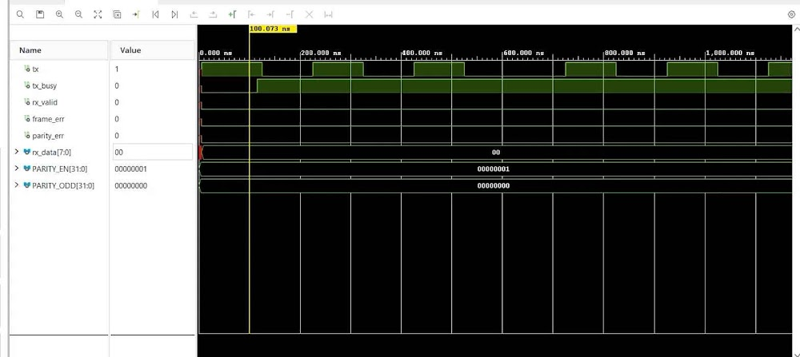
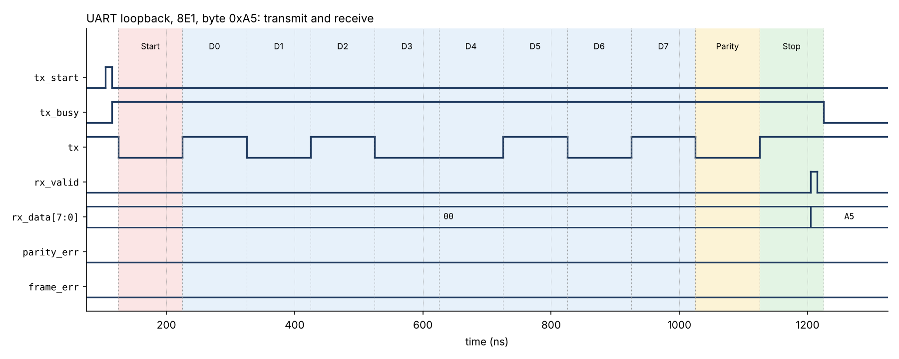
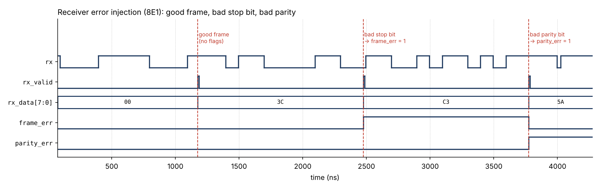

# UART in Verilog (TX + RX, optional parity)

A small, parameterizable UART transmitter and receiver written in Verilog,
with a self-checking testbench that covers normal operation and error cases.
Built as a learning project for digital design / VLSI.

- 8 data bits, 1 stop bit, **optional even or odd parity** (8N1, 8E1, 8O1)
- Configurable system clock and baud rate through parameters
- Receiver features: 2-flop input synchronizer, mid-bit sampling, glitch
  rejection, **framing-error** and **parity-error** flags, break-condition handling
- Self-checking testbench: 110 automatic checks, all passing in Icarus Verilog 12
  and in Xilinx Vivado simulation (simulation only; no hardware testing yet)

## Block diagram



## Repository layout

```
rtl/uart_tx.v       transmitter (FSM: IDLE, START, DATA, PARITY, STOP)
rtl/uart_rx.v       receiver    (2-FF sync, FSM, mid-bit sampling, error flags)
rtl/uart_top.v      wrapper that instantiates one TX and one RX
tb/tb_uart.v        self-checking testbench (loopback + error injection)
docs/               block diagram, waveform images, script that makes the waveforms
Makefile            `make sim` runs the tests, `make waves` regenerates waveform PNGs
```

## Parameters

| Parameter    | Default     | Meaning                                         |
|--------------|-------------|-------------------------------------------------|
| `CLK_FREQ`   | 100_000_000 | System clock frequency in Hz                    |
| `BAUD`       | 9600        | Baud rate; `CLKS_PER_BIT = CLK_FREQ / BAUD`     |
| `PARITY_EN`  | 0           | 0 = no parity, 1 = parity bit after D7          |
| `PARITY_ODD` | 0           | 0 = even parity, 1 = odd parity (if enabled)    |

## Ports

| Module   | Port         | Dir | Description                                                  |
|----------|--------------|-----|--------------------------------------------------------------|
| uart_tx  | `tx_start`   | in  | 1-clock pulse: send `tx_data`                                |
|          | `tx_data`    | in  | Byte to send                                                 |
|          | `tx`         | out | Serial line, idles high                                      |
|          | `busy`       | out | High while a frame is in progress                            |
| uart_rx  | `rx`         | in  | Asynchronous serial input                                    |
|          | `rx_data`    | out | Received byte                                                |
|          | `rx_valid`   | out | 1-clock pulse when a frame finished                          |
|          | `frame_err`  | out | Stop bit was 0 (valid with `rx_valid`)                       |
|          | `parity_err` | out | Parity mismatch (valid with `rx_valid`; always 0 if no parity) |

All modules use a synchronous, active-high `rst`. The receiver delivers the
byte even when an error flag is set, so the user logic can decide what to do.

## How it works

**Frame:** idle high, one start bit (0), 8 data bits LSB first, optional parity
bit, one stop bit (1).

**Transmitter:** a 5-state FSM with a clock counter that holds each bit for
`CLKS_PER_BIT` clocks. Parity is the XOR of the data bits (`^data`); odd
parity is its inverse.

**Receiver:**
1. The `rx` pin passes through two flip-flops (avoids metastability).
2. A falling edge starts the START state, which waits half a bit and checks
   the line is still 0 (otherwise it was a glitch and is ignored).
3. From there it samples every `CLKS_PER_BIT` clocks, which is the middle of
   each following bit.
4. At the stop bit it outputs the byte and sets `frame_err` if the stop bit is 0.
5. An `armed` flag lets the receiver start a new frame only after it has seen
   the line high, so a break condition or a bad stop bit does not create false
   start bits.

**Timing tolerance:** the receiver samples the stop bit about 9.5 bit times
after the start edge, so the combined TX + RX baud error must stay below about
5% (keep each side within roughly 2%).

## Verification

Run `make sim` (needs Icarus Verilog) or use Vivado (below). The testbench shrinks
the clock to 10 clocks per bit so simulation is fast.

| Test bench                  | What it checks                                                             | Checks |
|-----------------------------|----------------------------------------------------------------------------|--------|
| Loopback 8N1, 8E1, 8O1      | 5 fixed bytes (A5, 41, 00, FF, 55), 20 random bytes, 5 back-to-back bytes  | 90     |
| Receiver errors, no parity  | good frame, bad stop bit, glitch, recovery, break, recovery after break    | 6      |
| Receiver errors, even/odd   | the same plus bad parity bit                                               | 14     |

Result: **ALL TESTS PASSED** (110 checks). To confirm the checks are meaningful,
bugs were injected on purpose (inverted parity check, MSB-first transmit, frame
error never set, re-arm logic removed) and each one made the testbench fail.
Also checked at the real settings (100 MHz clock, 9600 baud, 8E1) with a single byte.

### Vivado simulation results

Full test run (8E1 loopback) with `ALL TESTS PASSED` in the Tcl Console:



Single frame, byte `0xA5` in 8E1 (start bit, data LSB first, parity 0, stop bit):



### Additional waveforms (Icarus Verilog)

Generated from the simulation's VCD file (`docs/make_waveforms.py`), not drawn by hand.

Loopback of byte `0xA5` in 8E1: start bit, data LSB first, parity (0 because
`0xA5` has four 1s), stop bit; `rx_valid` pulses in the middle of the stop bit.



Receiver error injection: a good frame, then a bad stop bit (`frame_err`),
then a bad parity bit (`parity_err`).



## Running it

**Icarus Verilog:**

```
make sim        # compile and run all tests
make waves      # also regenerate the PNGs (pip install vcdvcd matplotlib)
```

**Xilinx Vivado (simulation):**
1. Create an RTL project (any part, e.g. `xc7a35tcpg236-1`).
2. Add `rtl/*.v` as design sources and `tb/tb_uart.v` as a simulation source.
3. Set `tb_uart` as the simulation top, then Run Behavioral Simulation.
4. The Tcl console prints `PASS`/`FAIL` lines and finally `ALL TESTS PASSED`.

## Limitations and future work

- Fixed 8 data bits and 1 stop bit
- One sample per bit (no 16x oversampling or majority vote)
- No FIFOs, so no overrun detection
- Verified in simulation only; not yet tested on an FPGA board
- Synthesis results (LUT/FF count, Fmax) not collected yet
- Ideas: 16x oversampling, TX/RX FIFOs, configurable data bits and stop bits,
  FPGA echo demo with a PC terminal
